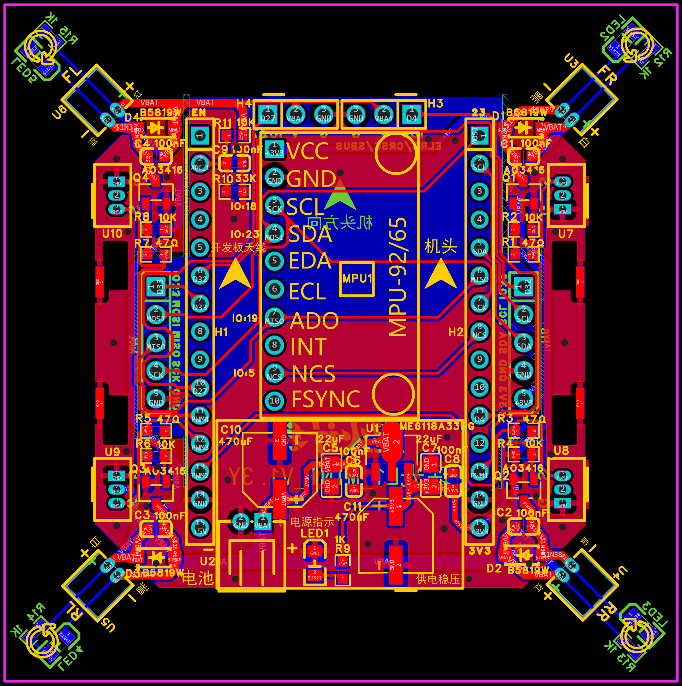
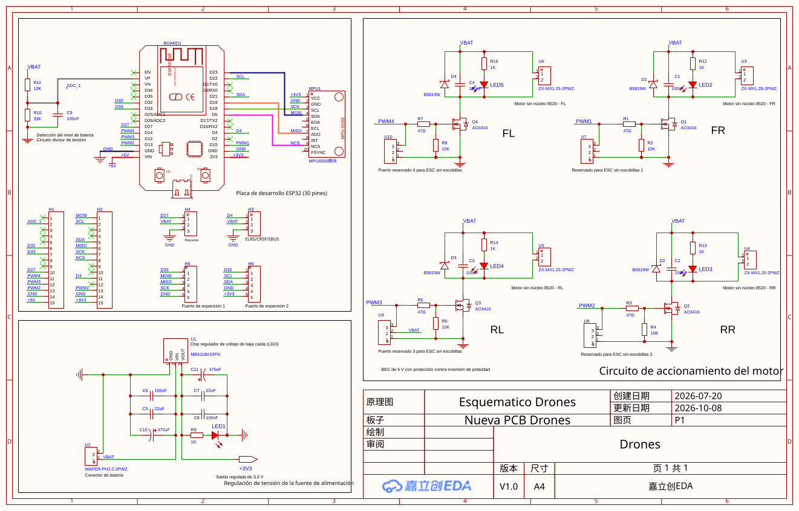

# PCB Drones — controladora de cuadricóptero con ESP32

Diseño de PCB (esquemático y placa) para el cuadricóptero del proyecto de Robótica Aérea, editado en **EasyEDA Pro**.

## Archivos

| Archivo | Para qué sirve |
|---|---|
| [`img/Esquematico.svg`](img/Esquematico.svg) | Ver el esquemático en el navegador |
| [`img/PCB.png`](img/PCB.png) | Ver la placa en el navegador |
| [`Gerber_PCB_Drones.zip`](Gerber_PCB_Drones.zip) | Fabricar la placa (JLCPCB, PCBWay u otro fabricante) |
| [`BOM_Drones.csv`](BOM_Drones.csv) | Lista de materiales generada desde el proyecto |
| [`COMPONENTES.md`](COMPONENTES.md) | Componentes por bloque, con proveedores en Colombia |
| [`Drones.epro2`](Drones.epro2) | Proyecto editable: abrir en EasyEDA Pro con *File → Import → EasyEDA Pro* |

## Resumen de la placa

- **Tamaño:** 72,5 × 80,6 mm, 2 capas, espesor recomendado 1,6 mm.
- **Controlador:** ESP32 DevKit de 30 pines montada sobre H1/H2.
- **IMU:** módulo MPU (SPI: MISO/MOSI/SCK/NCS; I2C disponible en H6: SDA/SCL).
- **Alimentación:** batería LiPo 1S (3,7–4,2 V) por U2 → regulador LDO ME6118A33 a 3,3 V (U1).
- **Motores:** 4 motores DC *coreless* conmutados por MOSFET AO3416 (Q1–Q4) con diodo Schottky B5819W, controlados por las señales PWM1–PWM4.
- **Medición de batería:** divisor R11 (10 kΩ) / R10 (33 kΩ) hacia la entrada ADC_1 de la ESP32 (≈ 3,2 V con la batería llena).
- **Expansión:** H3/H4 (señales D4 y D27, con VBAT y GND) y H5/H6 (bus SPI e I2C) para sensores o módulos adicionales.

## Esquemático

## Origen y licencia

Este diseño es una **adaptación** del proyecto de hardware abierto
*琛光E1 Mini ESP32无人机 开源版* (Chenguang / cherglowtech), publicado en [OSHWHub](https://oshwhub.com)
bajo licencia **CC BY-NC-SA** (atribución, no comercial, compartir igual).
Firmware original del autor: <https://github.com/songge8/CF-Drone>.

Esta versión modificada se distribuye bajo la misma licencia **CC BY-NC-SA 4.0**, solo con fines académicos.

Adaptado por: Brayan Manrique — Robótica Aérea, Universidad Militar Nueva Granada, 2026-II.
